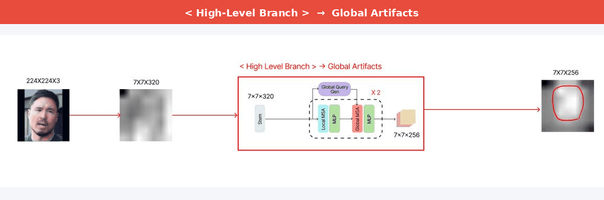
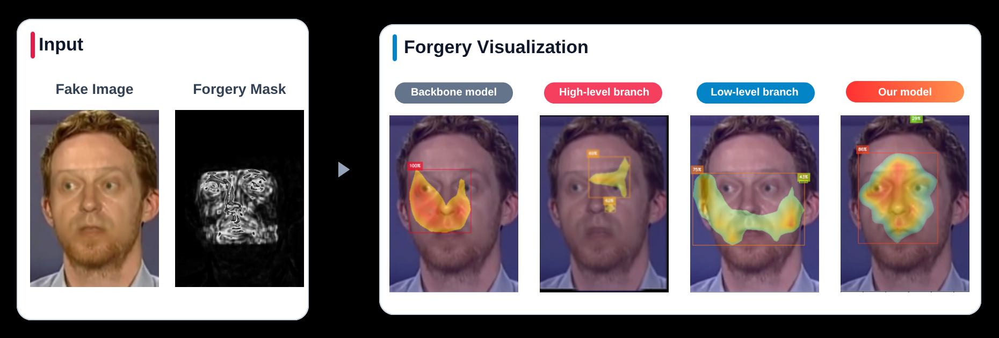
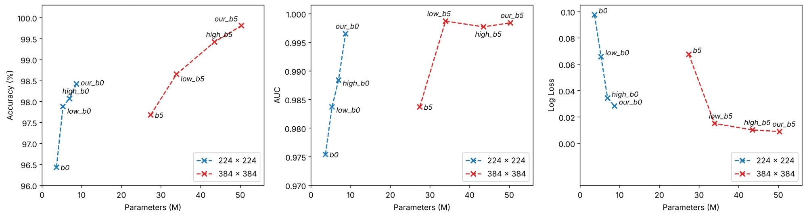
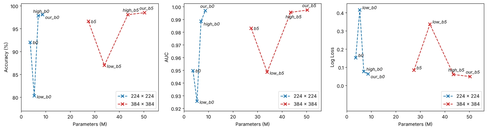
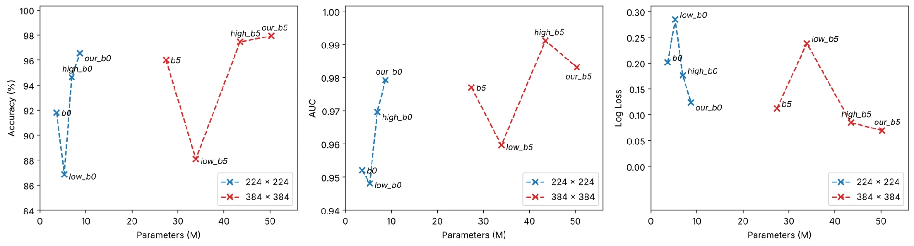

# Ablation Study

  

- ** (_Subtle Artifacts_)**: High-Resolution feature maps are extracted from early backbone blocks(`l_block_idx`) to capture like skin texture or boundary artifacts

- ** (_Global Features_)**: Low-Resolution feature maps are extracted from deeper blocks(`h_block_idx`) to analyze overall lighting, shadows, and structural consistency.

- **Feature Fusion**: The Outputs from both branches (`L-GCViT and H-GCViT`) are fused to make a comprehensive decision based on both local and global context.

## Ablation Model Zoo

| Model | Branch | Resolution | # Params(M) | #FLOPs(G) |
| :--- | :---: | :---: | :---: | :---: |
| eff_b0 |  | 224 × 224 | 3.65M | 0.76G |
| eff_b5 |  | 384 × 384 | 27.42M | 13.79G |
| low_eff_gcvit_b0 |  | 224 × 224 | 5.30M | 0.79G |
| low_eff_gcvit_b5 |  | 384 × 384 | 33.92M | 10.70G |
| high_eff_gcvit_b0 |  | 224 × 224 | 6.94M | 1.08G |
| high_eff_gcvit_b5 |  | 384 × 384 | 43.51M | 18.59G |

## Ablation Feature map

  

# Ablation Evaluation

### Celeb DF(V2)

  

| Model | Branch | Test@Acc | Test@Auc | Test@log_loss | Download | Train Config |
| ------------- | -------- | -------- | -------- | ---------- | -------- | ----- |
| eff_b0 |  | 0.9643 | 0.9754 | 0.0977 | [model](https://github.com/HanMoonSub/DeepGuard/releases/download/v1.1.0/eff_b0_celeb_df_v2.bin) | [recipe](../deepguard/config/eff_b0/celeb_df_v2.yaml) |
| eff_b5 |  | 0.9768 | 0.9837 | 0.0676 | [model](https://github.com/HanMoonSub/DeepGuard/releases/download/v1.1.0/eff_b5_celeb_df_v2.bin) | [recipe](../deepguard/config/eff_b5/celeb_df_v2.yaml) |
| low_eff_gcvit_b0 |  | 0.9788 | 0.9837 | 0.0658 | [model](https://github.com/HanMoonSub/DeepGuard/releases/download/v1.1.0/low_eff_gcvit_b0_celeb_df_v2.bin) | [recipe](../deepguard/config/low_eff_gcvit_b0/celeb_df_v2.yaml) |
| low_eff_gcvit_b5 |  | 0.9865 | 0.9987 | 0.0150 | [model](https://github.com/HanMoonSub/DeepGuard/releases/download/v1.1.0/low_eff_gcvit_b5_celeb_df_v2.bin) | [recipe](../deepguard/config/low_eff_gcvit_b5/celeb_df_v2.yaml) |
| high_eff_gcvit_b0 |  | 0.9807 | 0.9884 | 0.0343 | [model](https://github.com/HanMoonSub/DeepGuard/releases/download/v1.1.0/high_eff_gcvit_b0_celeb_df_v2.bin) | [recipe](../deepguard/config/high_eff_gcvit_b0/celeb_df_v2.yaml) |
| high_eff_gcvit_b5 |  | 0.9942 | 0.9977 | 0.0101 | [model](https://github.com/HanMoonSub/DeepGuard/releases/download/v1.1.0/high_eff_gcvit_b5_celeb_df_v2.bin) | [recipe](../deepguard/config/high_eff_gcvit_b5/celeb_df_v2.yaml) |

### FaceForensics++

  

| Model | Branch | Test@Acc | Test@Auc | Test@log_loss | Download | Train Config |
| ------------- | -------- | -------- | -------- | ---------- | -------- | ------ |
| eff_b0 |  | 0.9202 | 0.9497 | 0.1523 | [model](https://github.com/HanMoonSub/DeepGuard/releases/download/v1.1.0/eff_b0_ff++.bin) | [recipe](../deepguard/config/eff_b0/ff++.yaml) |
| eff_b5 |  | 0.9660 | 0.9831 | 0.0842 | [model](https://github.com/HanMoonSub/DeepGuard/releases/download/v1.1.0/eff_b5_ff++.bin) | [recipe](../deepguard/config/eff_b5/ff++.yaml) |
| low_eff_gcvit_b0 |  | 0.8033 | 0.9257 | 0.4148 | [model](https://github.com/HanMoonSub/DeepGuard/releases/download/v1.1.0/low_eff_gcvit_b0_ff++.bin) | [recipe](../deepguard/config/low_eff_gcvit_b0/ff++.yaml) |
| low_eff_gcvit_b5 |  | 0.8700 | 0.9486 | 0.3365 | [model](https://github.com/HanMoonSub/DeepGuard/releases/download/v1.1.0/low_eff_gcvit_b5_ff++.bin) | [recipe](../deepguard/config/low_eff_gcvit_b5/ff++.yaml) |
| high_eff_gcvit_b0 |  | 0.9783 | 0.9886 | 0.0767 | [model](https://github.com/HanMoonSub/DeepGuard/releases/download/v1.1.0/high_eff_gcvit_b0_ff++.bin) | [recipe](../deepguard/config/high_eff_gcvit_b0/ff++.yaml) |
| high_eff_gcvit_b5 |  | 0.9808 | 0.9956 | 0.0606 | [model](https://github.com/HanMoonSub/DeepGuard/releases/download/v1.1.0/high_eff_gcvit_b5_ff++.bin) | [recipe](../deepguard/config/high_eff_gcvit_b5/ff++.yaml) |

### Kodf 

  

| Model | Branch | Test@Acc | Test@Auc | Test@log_loss | Download | Train Config |
| ------------- | -------- | -------- | -------- | ---------- | -------- | ------ |
| eff_b0 |  | 0.9180 | 0.9520 | 0.2010 | [model](https://github.com/HanMoonSub/DeepGuard/releases/download/v1.1.0/eff_b0_kodf.bin) | [recipe](../deepguard/config/eff_b0/kodf.yaml) |
| eff_b5 |  | 0.9601 | 0.9770 | 0.1120 | [model](https://github.com/HanMoonSub/DeepGuard/releases/download/v1.1.0/eff_b5_kodf.bin) | [recipe](../deepguard/config/eff_b5/kodf.yaml) |
| low_eff_gcvit_b0 |  | 0.8684 | 0.9481 | 0.2843 | [model](https://github.com/HanMoonSub/DeepGuard/releases/download/v1.1.0/low_eff_gcvit_b0_kodf.bin) | [recipe](../deepguard/config/low_eff_gcvit_b0/kodf.yaml) |
| low_eff_gcvit_b5 |  | 0.8808 | 0.9596 | 0.2381 | [model](https://github.com/HanMoonSub/DeepGuard/releases/download/v1.1.0/low_eff_gcvit_b5_kodf.bin) | [recipe](../deepguard/config/low_eff_gcvit_b5/kodf.yaml) |
| high_eff_gcvit_b0 |  | 0.9462 | 0.9696 | 0.1761 | [model](https://github.com/HanMoonSub/DeepGuard/releases/download/v1.1.0/high_eff_gcvit_b0_kodf.bin) | [recipe](../deepguard/config/high_eff_gcvit_b0/kodf.yaml) |
| high_eff_gcvit_b5 |  | 0.9745 | 0.9911 | 0.0844 | [model](https://github.com/HanMoonSub/DeepGuard/releases/download/v1.1.0/high_eff_gcvit_b5_kodf.bin) | [recipe](../deepguard/config/high_eff_gcvit_b5/kodf.yaml) |

